

  
  
  
  

  
<a href="#about-me">About</a> · <a href="#featured-projects">Projects</a> · <a href="#technical-toolkit">Skills</a> · <a href="#research">Research</a> · <a href="#achievements--leadership">Achievements</a>

---

## About Me


## Technical Toolkit


## Featured Projects

<a href="https://github.com/nandini17404/POWER-BI-Projects"></a>

[Explore repository →](https://github.com/nandini17404/POWER-BI-Projects)

<a href="https://github.com/nandini17404/DATASCIENCE/tree/main/Customer%20Churn%20Prediction"></a>

[Explore repository →](https://github.com/nandini17404/DATASCIENCE/tree/main/Customer%20Churn%20Prediction)

<a href="https://github.com/nandini17404/DATASCIENCE/tree/main/Customer%20Segmentation%20%26%20Persona%20Analysis"></a>

[Explore repository →](https://github.com/nandini17404/DATASCIENCE/tree/main/Customer%20Segmentation%20%26%20Persona%20Analysis)

<a href="https://github.com/nandini17404/DATASCIENCE/tree/main/Next-Generation%20Time-Series%20Forecasting"></a>

[Explore repository →](https://github.com/nandini17404/DATASCIENCE/tree/main/Next-Generation%20Time-Series%20Forecasting)

<a href="https://github.com/nandini17404/DATASCIENCE/tree/main/FashionMNIST%20Image%20Classification%20Using%20ANN%20and%20CNN"></a>

[Explore repository →](https://github.com/nandini17404/DATASCIENCE/tree/main/FashionMNIST%20Image%20Classification%20Using%20ANN%20and%20CNN)


## Experience


## Research


[Read IEEE publication →](https://doi.org/10.1109/IGNITE69592.2026.11706245)

## Achievements & Leadership


## Certifications


## GitHub Activity

## Beyond Technology

Researcher · Orator · Student Leader · Lifelong Learner

## Connect

[LinkedIn](https://www.linkedin.com/in/nandini-sandip-gupta/) · [Portfolio](https://nandini-gupta-portfolio.netlify.app/) · [Email](mailto:n172630@gmail.com)

