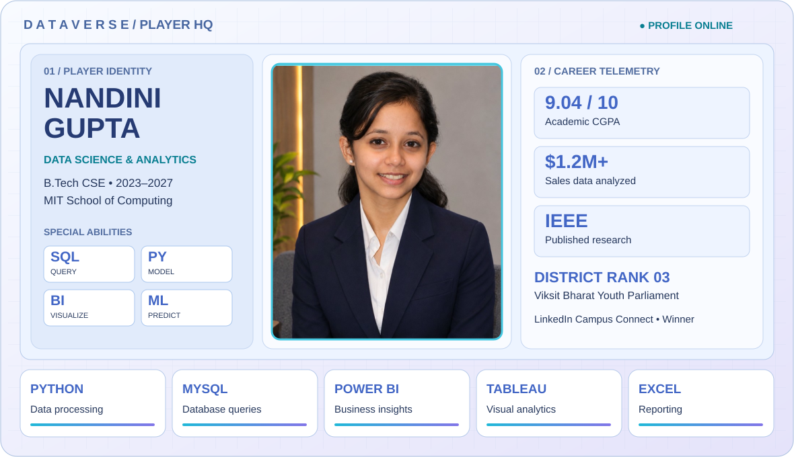
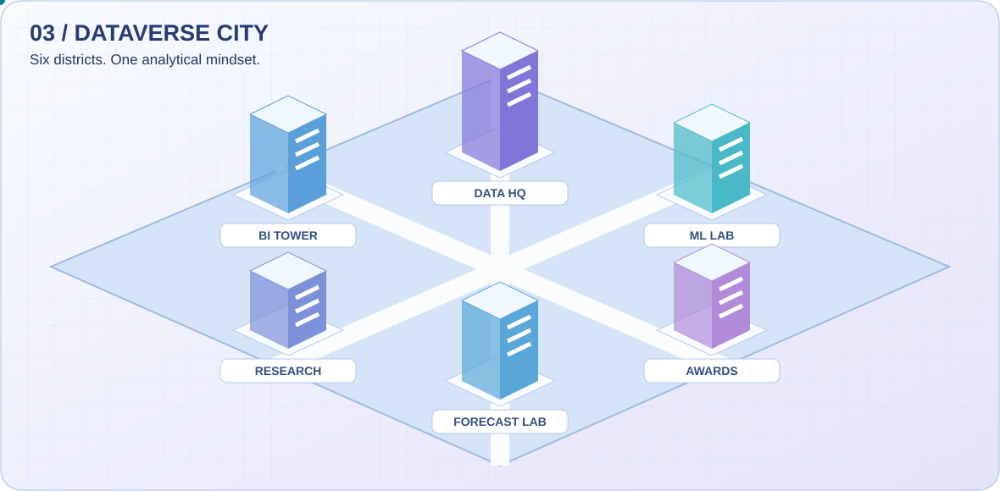
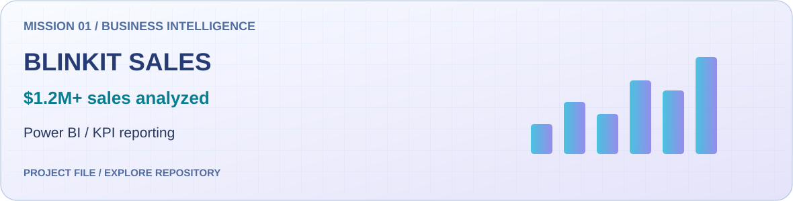
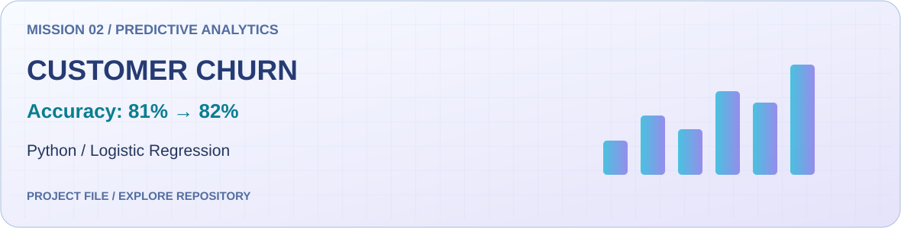
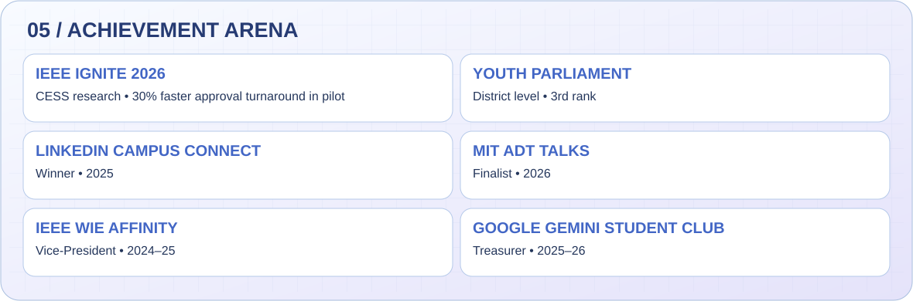

[LinkedIn](https://www.linkedin.com/in/nandini-sandip-gupta/) · [Portfolio](https://nandini-gupta-portfolio.netlify.app/) · [Email](mailto:n172630@gmail.com)

## Mission board

[Read IEEE research paper](https://doi.org/10.1109/IGNITE69592.2026.11706245)

## About

Computer Science undergraduate focused on data science, analytics and business intelligence. Skilled in Python, SQL, Power BI, Tableau, Excel, Pandas and Scikit-learn.
