<picture>
  <source media="(prefers-color-scheme: dark)" srcset="./assets/adhd-hero-dark.svg">
  
</picture>

<b>Nandini Gupta</b>

#### Signal

<picture>
  <source media="(prefers-color-scheme: dark)" srcset="./assets/adhd-signal-dark.svg">
  
</picture>

Reading the signal

- **Seismograph:** one swing of the pen per day of the last 365. The bigger the swing, the busier the day. Orange bands mark hyperfocus episodes, the most intense runs of back-to-back busy days. The biggest, HF-1, ran 4 days and logged 48 contributions.
- **Time, as experienced:** there are two times, now and not now. The bars under the clock are contributions by weekday (busiest: Thu).
- **Counters:** longest streak, contributions in the last 12 months, active days, stars, followers and years on GitHub.
- **Dopamine by source:** language share by bytes across public repositories.
- **The opening shot:** autofocus hunts through the noise, then locks on. The out-of-focus lights behind it are the last 12 months, one per month; bigger and brighter means busier.

ADHD isn’t a shortage of attention. Attention goes where interest is, and when it gets there it locks on hard. Artwork: original animated SVG, generated by README Templates · template: ADHD. Motion stops if your system asks for reduced motion.

#### Open tabs

- `TAB 01` **[Campus-Maintenance-System](https://github.com/nandini17404/Campus-Maintenance-System)** · Its is a website made for  handling maintenance in college or School level  
  TypeScript
- `TAB 02` **[DATASCIENCE](https://github.com/nandini17404/DATASCIENCE)** · Data Science Projects(From beginner to advance)  
  Jupyter Notebook
- `TAB 03` **[POWER-BI-Projects](https://github.com/nandini17404/POWER-BI-Projects)**  
- `TAB 04` **[CHAICULTUREASSIGNMENT](https://github.com/nandini17404/CHAICULTUREASSIGNMENT)**  
  TypeScript

<picture>
  <source media="(prefers-color-scheme: dark)" srcset="./assets/adhd-end-dark.svg">
  
</picture>

