[ Blinkit Analytics ](https://github.com/nandini17404/POWER-BI-Projects) · [ Customer Churn ](https://github.com/nandini17404/DATASCIENCE/tree/main/Customer%20Churn%20Prediction) · [ Segmentation ](https://github.com/nandini17404/DATASCIENCE/tree/main/Customer%20Segmentation%20%26%20Persona%20Analysis) · [ Forecasting ](https://github.com/nandini17404/DATASCIENCE/tree/main/Next-Generation%20Time-Series%20Forecasting) · [ Fashion-MNIST ](https://github.com/nandini17404/DATASCIENCE/tree/main/FashionMNIST%20Image%20Classification%20Using%20ANN%20and%20CNN)

[Read IEEE publication](https://doi.org/10.1109/IGNITE69592.2026.11706245)

[LinkedIn](https://www.linkedin.com/in/nandini-sandip-gupta/) · [Portfolio](https://nandini-gupta-portfolio.netlify.app/) · [Email](mailto:n172630@gmail.com)
